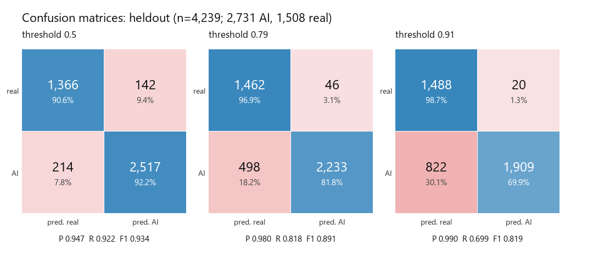
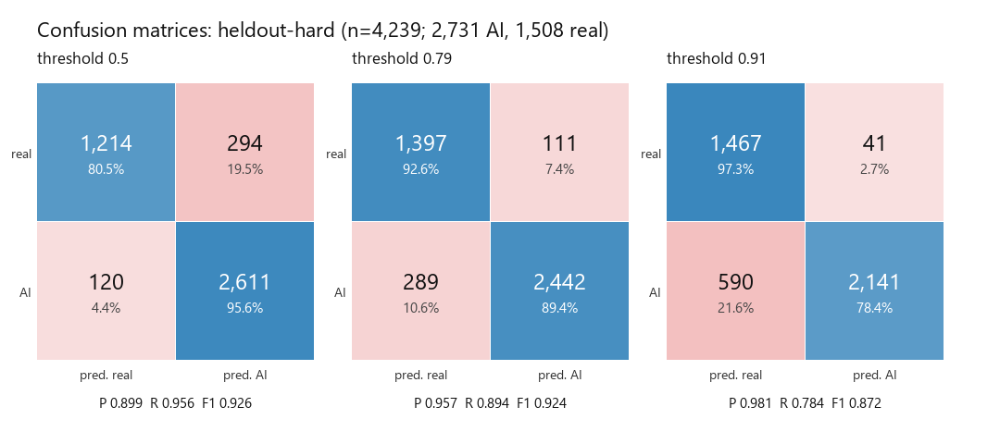
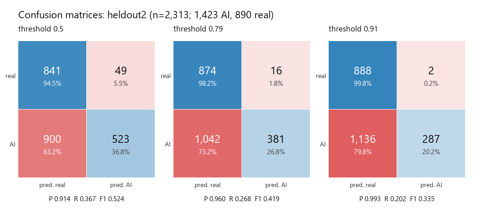
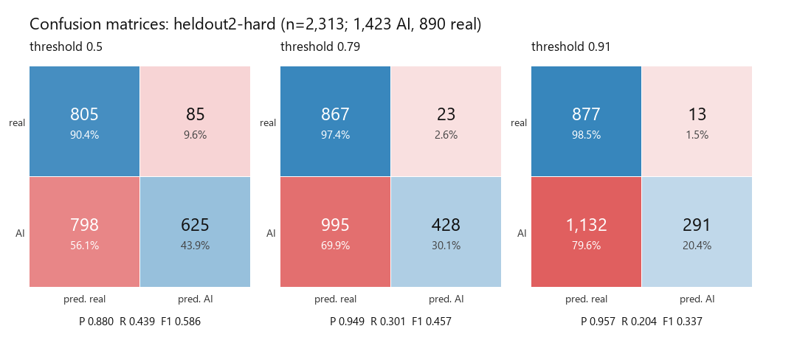

# Evaluation

Measured on 2026-10-20. Every number below was computed by the script named under its table;
none is estimated. Database latency and the live pipeline timings are in
[`benchmarks.md`](benchmarks.md); how the detector was built is in [`ml/README.md`](../ml/README.md)
and [`ml/MODEL_CARD.md`](../ml/MODEL_CARD.md).

## 1. Detector metrics

**Setup.** "AI" is the positive class. The test images come from generators that were never in
training (split by generator, not by image), so these measure generalization. Scores are the
shipped v3 head (`clip-vitb16-mlp-v3`, temperature 1.176) applied to cached CLIP ViT-B/16
features of the standardized images (shorter side 256 px, JPEG q90). The 8-bit ONNX model the
API serves differs from this fp32 head by 0.003 on average (`ml/eval_onnx.py`). "Recompressed"
means 50% downscale plus JPEG quality 60, applied to every image.

Three thresholds are reported, the ones the API uses (`backend/app/analyzers/detector.py`):
**0.5** (the usual decision point, not used by the API on its own), **0.79** (weak evidence)
and **0.91** (strong evidence, can decide alone).

Reproduce: `D:/metaproof/venv/Scripts/python.exe ml/eval_metrics.py` (needs torch to load the
head; features in `D:/metaproof/data/features`). Full numbers, including every per-generator
confusion matrix, are in [`ml/results_metrics.json`](../ml/results_metrics.json). Its AUCs match
`results_vitb16.v3.json` (0.9725, 0.9668, 0.7702, 0.7203).

### 1.1 Nine unseen 2023–24 generators (4,239 images: 2,731 AI, 1,508 real)

| Test | Threshold | Precision | Recall | F1 | Accuracy | Real flagged as AI | ROC-AUC |
| --- | --- | --- | --- | --- | --- | --- | --- |
| As-is | 0.5 | 0.947 | 0.922 | 0.934 | 91.6% | 9.4% | **0.972** |
| | 0.79 | 0.980 | 0.818 | 0.891 | 87.2% | 3.1% | |
| | 0.91 | 0.990 | 0.699 | 0.819 | 80.1% | 1.3% | |
| Recompressed | 0.5 | 0.899 | 0.956 | 0.927 | 90.2% | 19.5% | **0.967** |
| | 0.79 | 0.957 | 0.894 | 0.924 | 90.6% | 7.4% | |
| | 0.91 | 0.981 | 0.784 | 0.872 | 85.1% | 2.7% | |

Confusion matrices (rows are the true class, columns the prediction; the shade shows the share
of the true class):

Reading it: at the 0.91 strong-evidence threshold the detector is right 99% of the time when it
says AI (20 false alarms in 1,929 flags), at the cost of missing 30% of AI images, which then
fall back to the weaker bands. Recompression makes the model *more* eager (more real photos
cross every threshold, and more AI images too); that is why the strong threshold sits high.

### 1.2 Per generator (same test, one generator against all real images)

Recall is the share of that generator's images scored at or above the threshold. AUC separates
that generator from the 1,508 real images. Precision and F1 are not tabulated per generator
because they depend on how many images each class has in the pair (about 300 AI against 1,508
real here), so they would not be comparable across tables; they are in the JSON.

| Generator | Images | AUC | Recall @0.5 | Recall @0.91 | AUC recompressed | Recall @0.5 recomp. | Recall @0.91 recomp. |
| --- | --- | --- | --- | --- | --- | --- | --- |
| Dalle3 | 301 | 0.986 | 96.4% | 78.7% | 0.979 | 97.0% | 87.0% |
| FLUX-dev | 300 | 0.972 | 92.0% | 69.3% | 0.957 | 93.7% | 71.3% |
| FLUX-schnell | 303 | 0.962 | 89.1% | 64.0% | 0.949 | 93.7% | 68.3% |
| Firefly_Image3 | 302 | 0.989 | 97.4% | 82.1% | 0.980 | 98.3% | 83.8% |
| IdeogramV2 | 300 | 0.955 | 85.7% | 59.7% | 0.940 | 90.3% | 65.7% |
| Imagen3 | 301 | 0.973 | 92.0% | 68.8% | 0.968 | 95.3% | 80.4% |
| LCM_lora_sdxl | 300 | 0.952 | 85.3% | 53.7% | 0.973 | 96.7% | 81.3% |
| MidjourneyV6_1 | 324 | 0.975 | 93.8% | 71.3% | 0.967 | 95.7% | 77.2% |
| stable_cascade | 300 | 0.989 | 97.7% | 81.3% | 0.989 | 99.7% | 90.7% |

### 1.3 Newest generators, never seen in training (2,313 images: 1,423 AI, 890 real)

Nano Banana (1, Pro, 2), FLUX.2, GPT Image 2 and Qwen Image 2.1, with real photos from the same
benchmark. This is the detector's known weak spot (see the model card).

| Test | Threshold | Precision | Recall | F1 | Accuracy | Real flagged as AI | ROC-AUC |
| --- | --- | --- | --- | --- | --- | --- | --- |
| As-is | 0.5 | 0.914 | 0.368 | 0.524 | 59.0% | 5.5% | **0.770** |
| | 0.79 | 0.960 | 0.268 | 0.419 | 54.3% | 1.8% | |
| | 0.91 | 0.993 | 0.202 | 0.335 | 50.8% | 0.2% | |
| Recompressed | 0.5 | 0.880 | 0.439 | 0.586 | 61.8% | 9.6% | **0.720** |
| | 0.79 | 0.949 | 0.301 | 0.457 | 56.0% | 2.6% | |
| | 0.91 | 0.957 | 0.205 | 0.337 | 50.5% | 1.5% | |

| Generator | Images | AUC | Recall @0.5 | Recall @0.91 | AUC recompressed | Recall @0.5 recomp. | Recall @0.91 recomp. |
| --- | --- | --- | --- | --- | --- | --- | --- |
| FLUX.2 | 300 | 0.815 | 37.7% | 18.3% | 0.708 | 43.3% | 8.3% |
| FLUX.2-dev | 41 | 0.999 | 100.0% | 87.8% | 0.995 | 100.0% | 85.4% |
| FLUX.2-flex | 40 | 1.000 | 100.0% | 100.0% | 0.999 | 100.0% | 100.0% |
| FLUX.2-pro | 66 | 0.986 | 90.9% | 63.6% | 0.981 | 95.5% | 69.7% |
| GPT Image 2 | 300 | 0.651 | 21.0% | 5.3% | 0.551 | 18.7% | 4.3% |
| Nano Banana 2 | 300 | 0.680 | 21.3% | 7.7% | 0.736 | 41.0% | 18.3% |
| NanoBanana | 40 | 0.990 | 95.0% | 85.0% | 0.987 | 95.0% | 87.5% |
| NanoBananaPro | 36 | 0.981 | 91.7% | 72.2% | 0.982 | 97.2% | 83.3% |
| Qwen Image 2.1 | 300 | 0.771 | 23.7% | 5.0% | 0.688 | 33.0% | 4.0% |

The split is lopsided: FLUX.2 (300), GPT Image 2 (300), Nano Banana 2 (300) and Qwen Image 2.1
(300) carry most of the images, while the four smaller sets (Nano Banana, Nano Banana Pro,
FLUX.2 dev/flex/pro, 36–66 images each) come from a different source and are caught well. The honest summary: the newest
multimodal generators are mostly missed, and the strong threshold keeps false alarms on real
photos at 0.2% (1.5% recompressed) rather than catching them.

## 2. Robustness to edits

The live model (`backend/models/detector.onnx`, the 8-bit ONNX export) with the live bands (strong 0.91, weak 0.79),
on 928 images from the nine unseen generators (577 AI, 351 real), each change applied
identically to real and AI images. Reproduce: `python ml/eval_robustness.py --chunks 40 --plan plan_heldout.v3.json`
(results: [`ml/results_robustness.json`](../ml/results_robustness.json)). This is a 928-image subset, so its
"original" row (AUC 0.976) differs slightly from the full-test numbers in section 1.

| Change | AUC | Real photos at strong (≥0.91) | Real at weak (≥0.79) | AI at strong | AI above 0.5 |
| --- | --- | --- | --- | --- | --- |
| none (`original`) | 0.976 | 0.3% | 2.3% | 70.7% | 92.4% |
| centre crop (60) (`crop_center_60`) | 0.961 | 0.6% | 2.6% | 55.6% | 86.0% |
| corner crop (50) (`crop_corner_50`) | 0.951 | 0.0% | 0.0% | 40.6% | 78.7% |
| 1080 px wide screenshot with dark UI bars, PNG (`screenshot`) | 0.948 | 0.0% | 1.1% | 41.1% | 80.1% |
| filter edit (`filter_edit`) | 0.967 | 1.4% | 2.6% | 64.0% | 91.0% |
| white meme caption band on top, JPEG q85 (`caption_band`) | 0.872 | 0.0% | 0.0% | 2.9% | 22.0% |
| rotated 3 degrees (`rotate_3deg`) | 0.971 | 0.3% | 1.7% | 61.5% | 90.1% |
| social-media recompression (`social_recompress`) | 0.967 | 0.9% | 2.0% | 59.8% | 89.8% |

- **False alarms stay low.** Real photos reach the strong band at most 1.4% of the time under every change, so the conservative design holds.
- **Detection falls on corner crops and screenshots**, from 70.7% to about 41% of AI images at the strong band.
- **A caption band nearly disables detection** (2.9% at strong, AUC 0.872). A likely cause is that the uniform band dominates the 256 px standardization and centre crop; trimming uniform borders before scoring is an untested candidate fix.

## 3. Provenance (C2PA) benchmark

**Data.** Published sample files from the C2PA project, [`contentauth/c2pa-rs`](https://github.com/contentauth/c2pa-rs)
at commit `60f7cbd` (`sdk/tests/fixtures/`), dual-licensed MIT or Apache-2.0 (licence texts
are saved with the files). 13 of those fixtures are signed JPEGs; 9 more are images without
credentials. Files were downloaded into an empty `D:/metaproof/data/c2pa_samples` and are not
committed. Group membership is checked from the bytes (a manifest store contains a `jumb` box),
not from the analyzer's answer.

| Group | How it is built | Files |
| --- | --- | --- |
| Valid | the 13 signed JPEGs, untouched | 13 |
| Tampered | the same 13 with one bit flipped in the compressed pixel data after signing: pixels change, manifest stays | 13 |
| Stripped | the same 13 re-saved with Pillow (JPEG q95), which drops the manifest | 13 |
| None | published images that never had credentials (JPEG, PNG and WebP) | 9 |

Each file goes through `backend/app/analyzers/c2pa_check.py` as the API runs it. Time is the
analyzer's wall time per file, 20 repeats per file after a warm-up, pooled across the group.
Reproduce: `python backend/scripts/benchmark_c2pa.py --dir D:/metaproof/data/c2pa_samples`
(results: [`backend/scripts/results_c2pa.json`](../backend/scripts/results_c2pa.json)).

| Group | Credentials detected | Analyzer outcome | Time p50 / p95 |
| --- | --- | --- | --- |
| Valid (13) | 13 / 13 | 9 validate (8 `signed_edits`, 1 `valid`; one of the 8 also `ai_composite`), 3 `invalid`, 1 `unreadable` | 4.9 / 11.1 ms |
| Tampered (13) | 13 / 13 | 12 `invalid`, 1 `unreadable` | 5.2 / 11.1 ms |
| Stripped (13) | 0 / 13 | 13 `absent` | 0.3 / 0.6 ms |
| None (9) | 0 / 9 | 9 `absent` | 0.4 / 1.3 ms |

- **Tampering is caught:** all 9 tampered files whose untouched original validated were flagged
  `c2pa.invalid` (`assertion.dataHash.mismatch`). The other 4 were not valid to begin with
  (below), and the analyzer still flagged 3 of them `invalid` and 1 `unreadable`.
- **Stripping is invisible by design:** a re-saved file has no credentials, so it reports
  `c2pa.absent`, a neutral, weak finding, the same as a file that never had any. 0 of 13 stripped
  files raise an alarm, and none should: absence is not evidence.
- **No false alarms on credential-free files:** 9 / 9 report `absent`.
- **Four of the 13 published "signed" samples do not validate untouched.** The SDK's own codes
  are `claimSignature.mismatch` (E-sig-CA.jpg), `assertion.dataHash.mismatch` (XCA.jpg),
  `ingredient.manifest.missing` with `assertion.hashedURI.mismatch` (adobe-20220124-E-clm-CAICAI.jpg)
  and an unreadable pre-release manifest (prerelease.jpg). So the valid group's validation rate
  is 9 / 13, and the 13 count above includes these files rather than hiding them. I did not
  check why the C2PA repository keeps them; the SDK reports them as invalid.
- All signers in these samples use test certificates, so `signer_trusted` is false for every
  file. The analyzer reports this separately from tampering and does not treat it as a failure.
- Limits: the signed samples are all JPEG (the repository has no signed PNG or WebP fixture), the
  tamper is one bit-flip in JPEG scan data (not a metadata edit or a re-sign), and 13 files is a
  small sample: this checks the analyzer's behaviour on each case, not a rate for real traffic.

## 4. System performance

Per-stage times (upload, metadata, file structure, C2PA, watermark, AI detector, full report) for
1, 4 and 12 MP images are in [`benchmarks.md`](benchmarks.md#per-analyzer-time-measured-locally)
(script: `backend/scripts/benchmark_pipeline.py`); database latency, index recall and storage are
in the same file (script: `backend/scripts/benchmark_db.py`). Summary, p50 on a local laptop
with one CPU thread:

| Stage | 1 MP | 12 MP |
| --- | --- | --- |
| Upload (POST returns) | 105 ms | 165 ms |
| Metadata | 28 ms | 29 ms |
| File structure | 5 ms | 7 ms |
| C2PA | 2 ms | 6 ms |
| Watermark | 94 ms | 685 ms |
| AI detector (inference) | 752 ms | 875 ms |
| **Upload to finished report** | **1.03 s** | **1.82 s** |

On the production free instance (fractional CPU) the full report takes about 9 s; the detector
dominates there as well.
